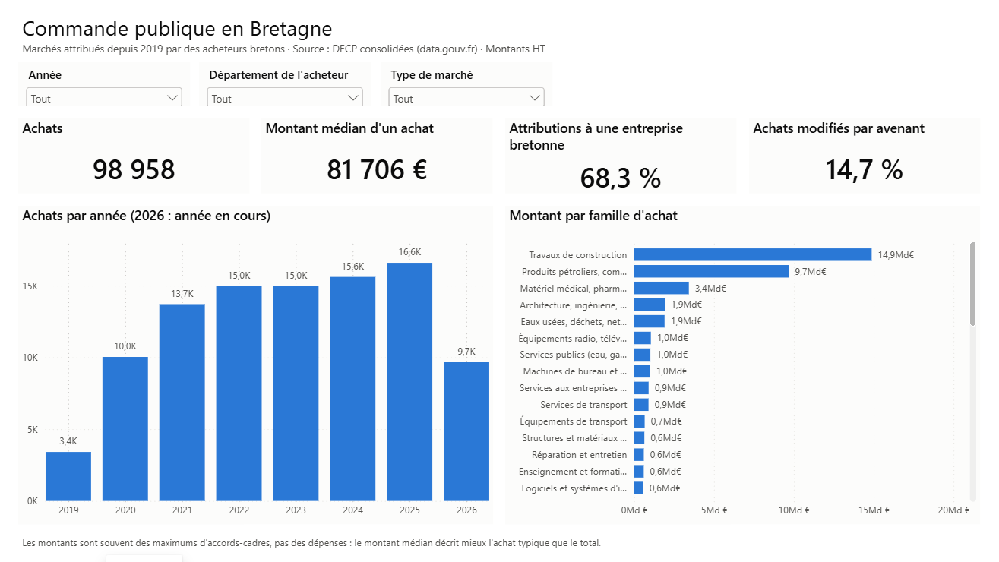

# Marchés publics Bretagne

Pipeline ETL, modèle en étoile, tableau de bord Power BI et détection d'anomalies sur
**99 000 marchés publics** passés par des acheteurs bretons depuis 2019 : qui achète quoi,
à qui, pour combien, et avec quelle concurrence.

**Données :** [Données essentielles de la commande publique (DECP) consolidées](https://www.data.gouv.fr/fr/datasets/donnees-essentielles-de-la-commande-publique-consolidees-format-tabulaire/),
data.gouv.fr, Licence Ouverte v2.0. Données réelles, aucune donnée inventée : seuls les marchés
dont l'acheteur est situé en Bretagne (région 53) sont extraits.



## Ce que montrent les données

- **Les PME remportent 54 % des marchés, mais seulement 22 % des montants** : beaucoup de petits
  marchés pour elles, les gros pour les ETI et les grandes entreprises.
- **87 % des marchés de travaux vont à des entreprises bretonnes** (29 km en médiane), contre
  40 % pour les fournitures.
- **Un marché de travaux sur cinq est modifié par avenant**, pour +5 % en cumulé.
- **Les clauses environnementales progressent** : 26 % des achats en 2024, 42 % en 2026.
- **Une fausse tendance évitée** : le taux d'offre unique semble tripler depuis 2019, mais c'est
  surtout un changement de format de publication — la donnée n'est connue que pour ~55 % des
  achats avant 2024, ~91 % après.

## Ce que le projet a dû corriger

Les données publiques sont riches mais imparfaites. Chaque problème trouvé est devenu une règle
de nettoyage écrite, testée et documentée :

| Problème | Impact | Étape |
|---|---|---|
| Un marché = une ligne par titulaire × modification, montant recopié | 16 Md€ comptés en double | [1](etapes/01-exploration.md) |
| 5 montants « bouche-trou » à 12 311 111 111 € | la moitié du total (61,6 Md€) | [2](etapes/02-modele.md) |
| Même marché publié par deux sources, ou une fois par lot | 9,1 Md€ comptés en double | [3](etapes/03-kpi.md) |
| Identifiants qui ne diffèrent que par la casse (`L` / `l`) | refusés par Power BI | [4a](etapes/04a-modele-power-bi.md) |
| SIRET mal formés, région inconnue comptée « non bretonne » | achat local sous-estimé (83 % au lieu de 87 %) | [4b](etapes/04b-tableau-de-bord.md) |
| Prix unitaires saisis à la place du montant total (1 €, 4,22 €…) | 914 achats signalés | [5](etapes/05-anomalies.md) |

## Le projet, étape par étape

Chaque étape a sa note : ce qui a été fait, pourquoi, et les résultats.

1. [Exploration des données brutes](etapes/01-exploration.md) — volumes, grain, pièges
2. [Nettoyage et modèle en étoile](etapes/02-modele.md) — staging, dimensions, faits, contrôles automatiques
3. [Indicateurs en SQL](etapes/03-kpi.md) — 8 KPI, couverture de chaque taux, dédoublonnage
4. [Modèle Power BI](etapes/04a-modele-power-bi.md) et [tableau de bord](etapes/04b-tableau-de-bord.md) — TMDL, mesures DAX validées contre le SQL, 5 pages
5. [Détection d'anomalies](etapes/05-anomalies.md) — 4 règles explicables, comparées à la référence

## Architecture

```
data.gouv.fr (Parquet national, ~250 Mo)
        │  pipeline/extract.py : lecture distante, filtre région 53
        ▼
data/raw/decp_bretagne.parquet  + source.json (URL, date, nb de lignes)
        │  sql/01..05 : nettoyage, modèle en étoile, KPI, anomalies
        │  sql/09     : 15 contrôles qualité (le build échoue si un seul est faux)
        ▼
data/decp.duckdb
        │  pipeline/export.py
        ▼
data/export/*.parquet  →  powerbi/MarchesBretagne.pbip (5 pages)
```

**Outils :** Python (uv), SQL (DuckDB), Parquet, Power BI (Power Query, DAX, format projet `.pbip`), Git.

## Démarrage

Prérequis : [uv](https://docs.astral.sh/uv/) (il installe Python et les dépendances)
et [Power BI Desktop](https://www.microsoft.com/fr-fr/power-platform/products/power-bi/desktop) (gratuit, Windows).

```bash
uv sync                                   # installe l'environnement
uv run python -m pipeline.extract         # télécharge les marchés bretons
uv run python -m pipeline.db build        # construit la base et lance les contrôles
uv run python -m pipeline.export          # exporte le modèle en Parquet pour Power BI
```

Puis ouvrir `powerbi/MarchesBretagne.pbip` et cliquer sur **Actualiser**. Si le projet est cloné
ailleurs que `C:\Users\pierre\Dev\decp-bretagne`, modifier le paramètre `DossierDonnees`
(Transformer les données → Paramètres).

Explorer avec un fichier SQL quelconque :

```bash
uv run python -m pipeline.db run sql/exploration/03_kpi.sql
```

## Organisation

| Dossier | Contenu |
|---|---|
| `pipeline/` | Extraction, exécution des fichiers SQL, export Parquet (Python) |
| `sql/` | Transformations, exécutées dans l'ordre (`01_` … `05_`) par `build`, puis contrôles (`09_`) |
| `sql/seeds/` | Petites tables de référence versionnées (familles CPV) |
| `sql/exploration/` | Requêtes d'exploration, non exécutées par `build` |
| `powerbi/` | Projet Power BI : modèle (TMDL), rapport (PBIR), générateur de pages `build_report.py` |
| `etapes/` | Une note par étape |
| `docs/captures/` | Captures des pages du tableau de bord |
| `schema.md` | Description de chaque colonne du jeu DECP |

## Limites

- Les montants sont souvent des **maximums d'accords-cadres**, pas des dépenses réelles :
  les totaux sont des ordres de grandeur, la médiane décrit mieux l'achat typique.
- La population des communes est absente de la source : pas de ratio par habitant
  (piste : croiser avec les données INSEE).
- Un signalement d'anomalie désigne un achat **à vérifier**, pas une faute avérée.
