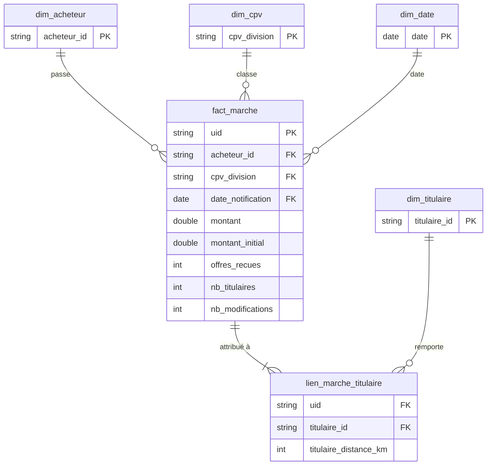

# Étape 2 — Nettoyage et modèle en étoile

**But :** transformer la table brute (une ligne = un marché × un titulaire × une version)
en un modèle propre, où chaque table a **un grain clair** et où aucun montant ne peut être
compté deux fois. C'est le « T » et le « L » de l'ETL.

**Fichiers :** [`sql/01_staging.sql`](../sql/01_staging.sql) → [`02_dimensions.sql`](../sql/02_dimensions.sql)
→ [`03_faits.sql`](../sql/03_faits.sql) → [`09_controles.sql`](../sql/09_controles.sql)
**Reconstruire :** `uv run python -m pipeline.db build` (≈ 3 secondes)

---

## Le modèle

| Table | Grain (1 ligne =) | Lignes |
|---|---|---:|
| `stg_decp` | marché × titulaire × version (comme la source) | 162 513 |
| `fact_marche` | **un marché**, version actuelle | 105 915 |
| `lien_marche_titulaire` | un couple marché × titulaire | 114 561 |
| `dim_acheteur` | un acheteur public | 1 711 |
| `dim_titulaire` | une entreprise titulaire | 17 074 |
| `dim_cpv` | une famille d'achat (division CPV) | 46 |
| `dim_date` | un jour (2010 → fin d'année en cours) | 6 209 |

### Pourquoi un modèle « en étoile » ?

Au centre, une **table de faits** : ce qu'on mesure (montants, nombre d'offres…), une ligne
par événement. Autour, des **dimensions** : ce par quoi on filtre et regroupe (qui achète,
quoi, quand). C'est le format que **Power BI attend** : chaque dimension filtre les faits par
une relation simple « un → plusieurs ».

### Et pourquoi une table de lien en plus ?

Un marché peut avoir **plusieurs titulaires** (4 410 cas). Si on mettait le titulaire dans
`fact_marche`, il faudrait dupliquer le marché… et donc son montant — exactement le piège
de l'étape 1 (16 Md€ en double). On sépare donc :
- le **montant** vit dans `fact_marche`, une fois par marché ;
- les **titulaires** vivent dans `lien_marche_titulaire`, sans montant.

C'est une table de **pont** (*bridge table*), la solution classique à une relation
plusieurs-à-plusieurs.

---

## 2a — Staging : nettoyer sans rien perdre

Le staging garde **toutes les lignes** et le même grain que la source. Il corrige les valeurs,
une colonne à la fois, en gardant la valeur brute quand elle a de l'importance
(`montant_brut`, `date_notification_brute`).

| Règle | Avant | Après |
|---|---|---|
| Procédures écrites de plusieurs façons (`Appel d offres`, `Appel d’offres`…) | 15 variantes | 9 libellés |
| Nature en majuscules / minuscules (`MARCHE`, `Marché`) | 10 variantes | 6 libellés |
| Type d'identifiant (`HORS-UE`, `HORS_UE`, `Siret`) | 10 variantes | 6 |
| `¿` à la place d'une apostrophe dans `objet` | 400 lignes | 0 |
| Code CPV invalide (pas 8 chiffres, ou division inexistante) | — | famille `??` (709 marchés) |
| Date hors de [2010, aujourd'hui] | an 2, an 17… | `NULL` (valeur brute conservée) |
| Durée ≤ 0 ou > 30 ans (−1 048 mois, 21 886 mois) | — | `NULL` |
| 0 offre reçue (impossible pour un marché attribué) | — | `NULL` |
| Version manquante (16 marchés sans `modification_id` ni `donneesActuelles`) | perdus | traités comme version unique |

**Concepts :**
- `CASE WHEN … THEN … END` : la règle de nettoyage écrite noir sur blanc, relisible.
- **Macro** `sans_accent()` : une fonction maison, pour comparer `Procédure adaptée` et
  `PROCEDURE ADAPTEE` sans se soucier des accents ni de la casse.
- `regexp_full_match(codeCPV, '\d{8}')` : vérifie que le code fait exactement 8 chiffres.
- **Fenêtre** `bool_or(...) OVER (PARTITION BY uid)` : « est-ce qu'au moins une ligne de ce
  marché est marquée actuelle ? », calculé sans regrouper les lignes.

### Le montant « retenu »

On garde trois informations : `montant_brut` (tel que publié), `motif_exclusion_montant`
(pourquoi on l'écarte) et `montant` (ce qu'on utilise dans les calculs).

Décomposition au niveau des marchés (version actuelle) :

| Motif | Marchés | Montant brut cumulé |
|---|---:|---:|
| Retenu | 96 618 | 52,96 Md€ |
| Valeur bouche-trou 12 311 111 111 € | 5 | **61,56 Md€** |
| Aberrant (`montant_anomalie`) | 127 | 10,67 Md€ |
| Nul ou négatif | 4 124 | ≈ 0 |
| Vide | 5 041 | — |
| **Total** | **105 915** | **125,19 Md€** |

**Le chiffre à retenir :** le total des montants passe de 125 Md€ (un montant par marché,
étape 1) à **53 Md€** une fois ces exclusions faites. À elles seules, les **5 valeurs
bouche-trou pesaient 61,6 Md€** — la moitié du total. Cinq lignes sur 160 000 suffisent à
rendre un tableau de bord faux : c'est pour ça qu'on regarde les extrêmes *avant* de calculer.

## 2b — Dimensions

- **`arg_max(nom, date_publication)`** : un acheteur apparaît sur des milliers de lignes,
  parfois avec un nom légèrement différent. On garde la version **la plus récente**.
- **Titulaire `INCONNU`** : 2 024 lignes n'ont pas d'identifiant de titulaire. Plutôt que de
  les supprimer (et perdre leurs marchés dans Power BI), elles pointent vers une ligne
  « Titulaire non renseigné ». Même principe pour la famille CPV `??`.
- **`dim_cpv`** : les 45 divisions de la nomenclature européenne CPV, dans
  [`sql/seeds/cpv_divisions.csv`](../sql/seeds/cpv_divisions.csv) (libellés courts rédigés
  d'après les intitulés officiels). Une *seed* est une petite table de référence versionnée avec le code.
- **`dim_date`** : un calendrier continu, avec les mois en français, généré par
  `generate_series`. Indispensable pour les courbes dans le temps sans trou.

## 2c — Faits

Deux pièges réglés ici :

1. **La date d'un marché modifié.** Sur la ligne « actuelle », `dateNotification` est la date
   du **dernier avenant**, pas celle de l'attribution. On va donc chercher la date à la
   modification 0 : `min(date_notification) FILTER (WHERE modification_id = 0)`.
2. **Le montant initial vs actuel.** On garde les deux : `montant_initial` (à l'attribution) et
   `montant` (aujourd'hui, avenants compris). Sur les 17 108 marchés modifiés, les avenants
   font monter le total de **1,7 %** — un indicateur qu'on mettra dans le tableau de bord.

**Concept — `DISTINCT ON (uid) … ORDER BY uid, titulaire_id`** : garde **une** ligne par
marché, choisie de façon déterministe (la même à chaque build).

## 2d — Contrôles automatiques

[`09_controles.sql`](../sql/09_controles.sql) rejoue 10 tests à chaque build ; **le build échoue
si un seul est faux**. Exemples : un marché = une ligne, aucun marché perdu depuis la source,
chaque clé étrangère existe dans sa dimension.

Ils ont servi dès le premier essai, en attrapant deux erreurs que je n'avais pas vues :

| Contrôle en échec | Cause | Correction |
|---|---|---|
| 16 marchés perdus | Ni `modification_id` ni `donneesActuelles` renseignés : le filtre `WHERE est_actuelle` les écartait. À l'étape 1, `bool_or()` sur une colonne entièrement vide renvoyait `NULL` — ni vrai ni faux — et ils étaient passés inaperçus. | Une ligne sans version, dans un marché sans autre version, est l'initiale et l'actuelle |
| 3 doublons dans le lien | Même couple marché × titulaire, distance renseignée sur une ligne et vide sur l'autre | `max(distance)` par couple |

**Leçon :** en SQL, `NULL` n'est ni vrai ni faux, et un `WHERE` l'écarte sans prévenir. Les
contrôles de cohérence (« combien j'en avais, combien j'en ai ») sont le filet de sécurité.

---

## À l'arrivée

| | |
|---|---:|
| Marchés | 105 915 |
| … avec un montant exploitable | 96 618 |
| … avec une date d'attribution valide | 105 842 |
| … avec une famille d'achat reconnue | 105 206 |
| Total des montants retenus | 53,0 Md€ |

> Ce total reste un ordre de grandeur : beaucoup de montants sont des **maximums d'accords-cadres**,
> pas des dépenses réelles. Le tableau de bord le dira explicitement.

**Prochaine étape :** les indicateurs (KPI) en SQL — concurrence, part des PME, achat local,
dérive des avenants — puis l'export vers Power BI.
