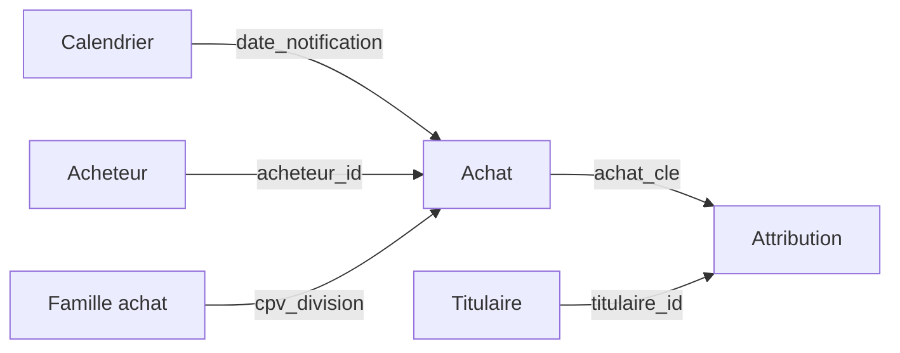

# Étape 4a — Le modèle Power BI

**But :** charger le modèle en étoile dans Power BI et y recréer les KPI en **DAX** (le langage
de calcul de Power BI), puis **prouver** que chaque mesure DAX donne le même chiffre que le SQL
de l'étape 3. Les pages du tableau de bord viennent à l'étape 4b.

**Fichiers :** [`pipeline/export.py`](../pipeline/export.py) ·
[`powerbi/MarchesBretagne.SemanticModel/`](../powerbi/MarchesBretagne.SemanticModel/definition)

```bash
uv run python -m pipeline.db build      # base DuckDB + contrôles
uv run python -m pipeline.export        # data/export/*.parquet
```
Puis ouvrir `powerbi/MarchesBretagne.pbip` dans Power BI Desktop et cliquer sur **Actualiser**.

---

## 1. L'export Parquet

Power BI ne lit pas DuckDB directement (il faudrait un pilote ODBC). On exporte donc chaque table
du modèle en **Parquet**, un format en colonnes, compressé et typé que Power BI lit nativement.

| Fichier | Contenu | Lignes |
|---|---|---:|
| `achat.parquet` | Faits : un achat dédoublonné, depuis 2019 | 98 958 |
| `attribution.parquet` | Pont achat × titulaire, montant ventilé | 108 063 |
| `acheteur.parquet` | Dimension acheteurs | 1 707 |
| `titulaire.parquet` | Dimension titulaires | 16 792 |
| `famille_achat.parquet` | Dimension familles CPV | 46 |
| `calendrier.parquet` | Dimension dates (2019 →) | 2 922 |

Tout le nettoyage reste dans le SQL : **Power BI ne transforme rien**, il affiche. Une seule
source de vérité, testée par les contrôles.

## 2. Le format projet (`.pbip`) : Power BI en fichiers texte

Un fichier `.pbix` classique est un binaire : impossible à relire dans Git. Le format **projet**
(`.pbip`) enregistre le rapport sous forme de fichiers texte :

```
powerbi/
├── MarchesBretagne.pbip                    ← le fichier à ouvrir
├── MarchesBretagne.SemanticModel/          ← le modèle (TMDL)
│   └── definition/
│       ├── expressions.tmdl                ← paramètre DossierDonnees
│       ├── relationships.tmdl              ← les 5 relations
│       └── tables/Achat.tmdl …             ← colonnes, mesures DAX, source Parquet
└── MarchesBretagne.Report/                 ← les pages et visuels (étape 4b)
```

**TMDL** (*Tabular Model Definition Language*) décrit le modèle : chaque table, ses colonnes,
d'où elle vient (une requête Power Query `Parquet.Document(...)`), et ses mesures. On peut le
relire, le comparer, le versionner comme du code.

**Le paramètre `DossierDonnees`** contient le chemin du dossier `data/export/`. Si le projet est
cloné ailleurs, c'est la seule chose à changer (Transformer les données → Paramètres).

## 3. Les relations



Les filtres « coulent » dans le sens des flèches : choisir une année dans `Calendrier` filtre
les `Achat`, qui filtrent à leur tour les `Attribution`. On peut donc afficher la part des PME
**pour 2024** ou **pour le Finistère** sans rien écrire de plus.

## 4. Les mesures DAX

17 mesures, rangées par dossier (Volume, Concurrence, Clauses, Avenants, Titulaires, Achat
local). Chacune traduit un KPI SQL. Exemple, le taux d'offre unique :

```sql
-- SQL (étape 3)
round(100.0 * count(*) FILTER (WHERE offres = 1) / nullif(count(offres), 0), 1)
```
```dax
-- DAX
Taux offre unique =
DIVIDE (
    COALESCE ( CALCULATE ( COUNTROWS ( Achat ), Achat[offres_recues] = 1 ), 0 ),
    COUNT ( Achat[offres_recues] )
)
```

**Concepts DAX :**
- **Mesure** : un calcul qui se réévalue selon les filtres de chaque visuel (une année, un
  département…). On ne stocke pas « le taux 2024 » : on stocke la formule.
- `CALCULATE ( expression, filtre )` : calcule l'expression en ajoutant un filtre — l'équivalent
  du `FILTER (WHERE …)` du SQL.
- `DIVIDE ( a, b )` : division qui renvoie vide au lieu d'une erreur si `b = 0`.
- `ALL ( Titulaire[taille_entreprise] )` : enlève un filtre, pour calculer un total et donc une
  part (« PME / toutes tailles »).

## 5. Validation : DAX = SQL

J'ai interrogé le moteur de Power BI directement (il tourne en local sur un port réseau) pour
calculer chaque mesure, et j'ai comparé aux KPI de l'étape 3.

| Indicateur | SQL | DAX |
|---|---:|---:|
| Achats | 98 958 | 98 958 |
| Montant total | 43,59 Md€ | 43,59 Md€ |
| Offre unique 2024 | 22,1 % | 22,1 % |
| Clause environnementale 2026 | 42,0 % | 42,0 % |
| PME : attributions / montant | 54,2 % / 21,6 % | 54,2 % / 21,6 % |
| Titulaires bretons (travaux) | 87,0 % | 87,0 % |
| Achats de travaux modifiés / évolution | 20,2 % / +5,0 % | 20,2 % / +5,0 % |

Toutes les valeurs (par année, par taille, par type) sont identiques.

### Deux problèmes trouvés grâce à Power BI

| Problème | Cause | Correction |
|---|---|---|
| Actualisation refusée : « valeur en double dans `achat_id` » | Deux marchés du CH de Saint-Brieuc ne diffèrent que par `…5234L_…` / `…5234l_…`. DuckDB distingue majuscules et minuscules, **Power BI non**. | Clé technique numérique `achat_cle` (1, 2, 3…) pour la relation — c'est de toute façon la bonne pratique (plus compacte, plus rapide). Nouveau contrôle SQL : clés uniques **sans tenir compte de la casse**. |
| Clauses 2020 : vide en DAX, 0 % en SQL | En DAX, compter zéro ligne donne **BLANK**, pas 0 ; un graphique aurait fait disparaître l'année. | `COALESCE ( …, 0 )` sur les numérateurs. |

**Leçon :** chaque outil a ses règles (casse, valeurs vides). Recalculer les mêmes chiffres dans
deux outils et les comparer est le moyen le plus sûr de les découvrir.

**Prochaine étape (4b) :** les pages du tableau de bord.
