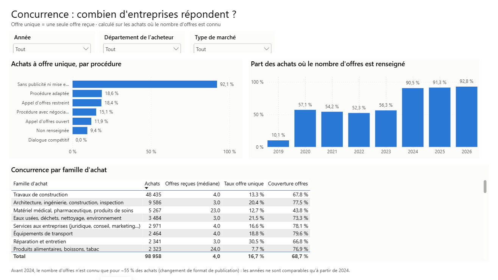
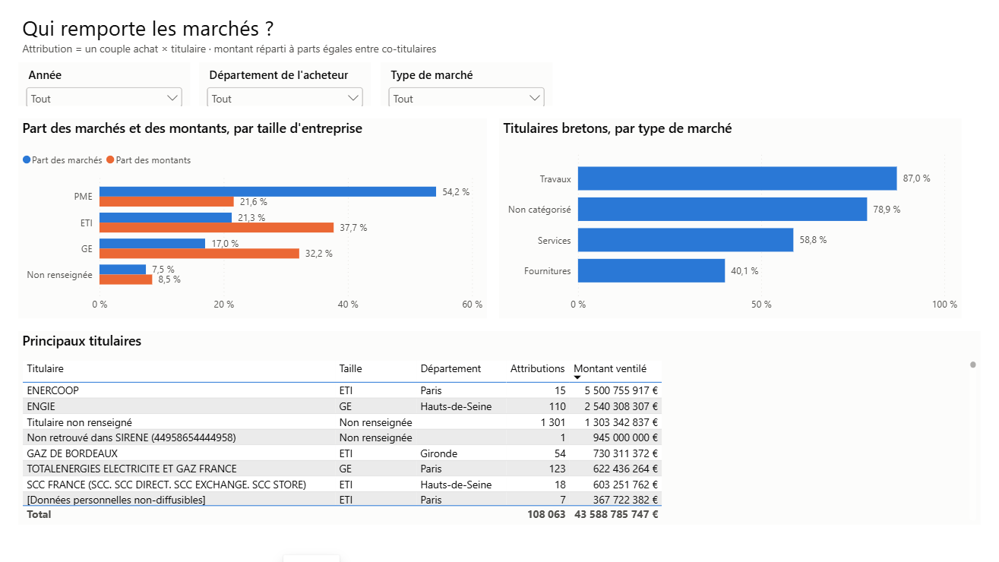
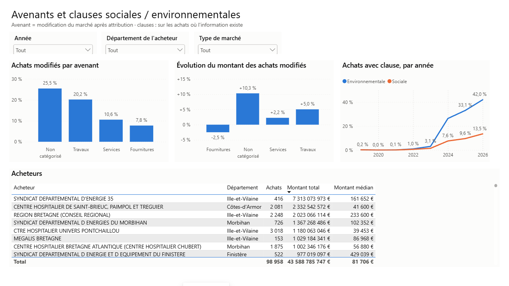

# Étape 4b — Le tableau de bord Power BI

**But :** construire les pages du rapport, chacune répondant à **une question**, sans jamais
mettre en avant un chiffre que l'analyse (étape 3) a jugé fragile.

**Fichiers :** [`powerbi/build_report.py`](../powerbi/build_report.py) (description des pages) ·
[`powerbi/MarchesBretagne.Report/`](../powerbi/MarchesBretagne.Report) (fichiers générés)

```bash
uv run python powerbi/build_report.py     # régénère les pages
```
Puis ouvrir `powerbi/MarchesBretagne.pbip` et cliquer sur **Actualiser** (les données ne sont
pas enregistrées dans Git, seulement leur définition).

---

## Les 4 pages

Chaque page a le même squelette : un titre qui pose la question, une ligne qui dit d'où viennent
les chiffres, trois segments (année, département, type de marché), puis les visuels.

### 1. Vue d'ensemble — *combien, et pour quoi ?*


Quatre chiffres clés, l'évolution du nombre d'achats, le montant par famille d'achat.

### 2. Concurrence — *combien d'entreprises répondent ?*



Le taux d'offre unique par procédure, **à côté de la couverture par année** : le lecteur voit
lui-même que les années avant 2024 ne sont pas comparables.

### 3. Entreprises — *qui remporte les marchés ?*



PME / ETI / grandes entreprises (part des marchés **et** des montants), achat local, principaux
titulaires.

### 4. Avenants et clauses — *les marchés bougent-ils, et sont-ils plus verts ?*



---

## Les choix de conception

| Choix | Pourquoi |
|---|---|
| **Pas de « Taux d'offre unique » ni de « clause environnementale » en carte d'accueil** | Ces deux chiffres mélangent des années où l'information n'est connue qu'à ~55 % et d'autres à ~95 %. Les mettre en vitrine contredirait l'analyse de l'étape 3. Ils sont présentés dans leur page, avec leur couverture. |
| **Montant médian en carte, pas le total** | Le total est dominé par quelques marchés géants (le marché d'électricité du SDE 35 pèse 5,4 Md€) ; la médiane décrit l'achat typique. |
| **Une couleur par série, palette vérifiée** | Bleu pour une série, bleu + orange pour deux. Ces couleurs sont choisies pour rester distinctes pour les daltoniens. |
| **Étiquettes de valeur, pas de titres d'axe** | Le titre du graphique dit déjà ce qu'on mesure ; le nom technique (`famille_achat`) n'apporte rien au lecteur. |
| **Note de bas de page** sur les pages sensibles | Les limites des données sont écrites là où on lit les chiffres, pas cachées dans un document à part. |

### Pourquoi un générateur plutôt que des clics ?

Dans Power BI, chaque visuel est un fichier JSON d'une centaine de lignes. Le script
[`build_report.py`](../powerbi/build_report.py) décrit chaque page en quelques lignes :

```python
bars((M, 152, 600, 256), col("Achat", "procedure"), [mes("Achat", "Taux offre unique")],
     "Achats à offre unique, par procédure", sort={"field": mes("Achat", "Taux offre unique")})
```

Avantages : la mise en page est **cohérente** (même grille, mêmes marges partout), une
modification (ex. masquer tous les titres d'axe) se fait **une fois**, et le rapport se relit
dans Git comme du code.

---

## Ce que la construction du tableau de bord a révélé

Regarder les chiffres en contexte, page par page, a fait apparaître trois problèmes que les
requêtes seules n'avaient pas montrés :

| Constat | Cause | Correction |
|---|---|---|
| Une ligne **sans nom** avec 4 202 attributions dans « Principaux titulaires » | 1 129 titulaires ont un SIRET **mal formé** (ex. `43399533943399` = SIREN répété), introuvable dans le répertoire SIRENE, donc sans nom ; le tableau les fusionnait. | **Règle 10** : libellé « Non retrouvé dans SIRENE (identifiant) », chaque titulaire reste distinct. |
| Part d'achat local sous-estimée | Ces mêmes titulaires, de région inconnue, étaient comptés « non bretons ». | `est_breton` vaut `NULL` si la région est inconnue ; la part se calcule sur les régions connues (~96 %). **Travaux : 83,4 % → 87,0 %.** SQL et DAX corrigés ensemble. |
| ENERCOOP premier titulaire avec 5,5 Md€ | C'est le marché d'électricité du SDE 35 marqué « suspect » (étape 3). Ce n'est pas une erreur de calcul. | Conservé et documenté ; il sera étudié à l'étape de détection d'anomalies. |

**Leçon :** *inconnu n'est pas « non ».* C'est la troisième fois dans ce projet (clauses à
l'étape 3, région ici) qu'une valeur manquante traitée comme un « non » fausse un indicateur.

**Prochaine étape :** la détection d'anomalies sur les montants, comparée à la colonne
`montant_anomalie` fournie dans les données.
