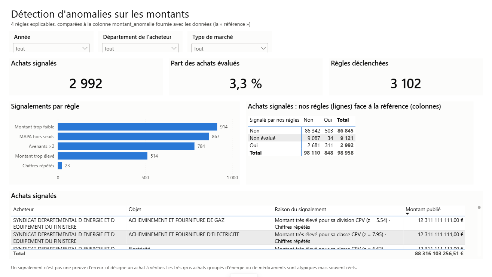

# Étape 5 — Détection d'anomalies sur les montants

**But :** repérer automatiquement les montants douteux, avec des règles **explicables** (chaque
achat signalé porte sa raison), puis comparer le résultat à la colonne `montant_anomalie` déjà
fournie dans les données — la « référence ».

**Fichiers :** [`sql/05_anomalies.sql`](../sql/05_anomalies.sql) · page « Anomalies » du tableau de bord

---

## Les 4 règles

On évalue les 89 837 achats (depuis 2019) dont le montant publié est positif, **y compris** ceux
que le nettoyage avait écartés — sinon la comparaison avec la référence serait truquée.

### Règle 1 — Montant hors norme par rapport à ses pairs

Un marché de travaux à 50 000 € est banal ; une table de découpe à 71 000 € l'est moins. On
compare donc chaque montant à des **achats comparables**, et non à l'ensemble.

1. **Échelle logarithmique.** Les montants vont de quelques euros à plusieurs milliards : on
   travaille sur `log10(montant)`, où « 10 fois plus » est un écart constant.
2. **Statistique robuste.** On mesure l'écart avec le **z modifié** :
   `z = 0,6745 × (x − médiane) / MAD`, où la MAD est la médiane des écarts à la médiane.
   La moyenne et l'écart-type, eux, seraient tirés par les valeurs extrêmes qu'on cherche — la
   médiane et la MAD ne le sont pas. Seuil classique : **|z| > 3,5**.
3. **Les pairs les plus fins possibles.** Le code CPV est hiérarchique : `45` (travaux) →
   `452` (ouvrages) → `4521` (bâtiments). On prend la **classe CPV** (4 chiffres) si elle compte
   au moins 30 achats, sinon le groupe, sinon la division, sinon le type de marché. Résultat :
   94 % des achats sont comparés à leur classe CPV.

Pourquoi la classe et pas la division ? Je l'ai **mesuré** :

| Niveau de pairs | Signalements (montants élevés) | Dont confirmés par la référence | Part de la référence retrouvée |
|---|---:|---:|---:|
| Division (2 chiffres) | 452 | 44 % | 24 % |
| Groupe (3 chiffres) | 472 | 52 % | 30 % |
| **Classe (4 chiffres)** | **514** | **52 %** | **33 %** |

### Règle 2 — Chiffres répétés

Au moins 6 chiffres identiques à la suite (hors zéros) sur un montant d'au moins 1 M€ :
attrape les valeurs saisies au clavier comme **12 311 111 111 €**.

### Règle 3 — Avenants : montant plus que doublé

Le montant actuel est au moins le double du montant initial.

### Règle 4 — Procédure adaptée au-dessus des seuils (« MAPA hors seuils »)

La procédure adaptée est réservée aux marchés **sous les seuils européens** (2024-2025 :
5 538 000 € HT en travaux, 221 000 € HT en fournitures et services pour les collectivités).
Une procédure adaptée à plus du double du seuil est incohérente. C'est une règle **métier** :
elle vient de la réglementation, pas de la statistique.

**Concept SQL — `coalesce(règle, false)` :** une règle doit répondre oui ou non. Sans montant
initial, la règle 3 renvoyait `NULL` (« on ne sait pas ») pour 368 achats, qui sortaient de tous
les comptages. Encore la logique à trois valeurs du SQL.

---

## Résultats

**2 992 achats signalés sur 89 837 évalués (3,3 %)**, pour 3 102 règles déclenchées.

| Règle | Achats | Aussi signalés par la référence |
|---|---:|---:|
| Montant trop faible | 914 | 0 |
| MAPA hors seuils | 867 | 49 |
| Avenants ×2 | 784 | 19 |
| Montant trop élevé | 514 | 265 |
| Chiffres répétés | 23 | 8 |

### Face à la référence

| | Référence : oui | Référence : non |
|---|---:|---:|
| **Nos règles : oui** | 311 | 2 681 |
| **Nos règles : non** | 503 | 86 342 |

La référence **n'est pas la vérité** : c'est elle aussi une méthode statistique (comparaison aux
« marchés similaires »). La comparaison sert à comprendre ce que chaque méthode voit.

**Ce que nos règles trouvent et que la référence ne cherche pas :**
- **Montants trop faibles** (914) : 4,22 € pour un marché de repas, 1 € pour de l'électroménager.
  Ce sont des **prix unitaires saisis à la place du montant total** — une erreur fréquente que la
  référence ignore complètement (elle ne regarde que les montants trop élevés).
- **La valeur bouche-trou du gaz** (12 311 111 111 €) que la référence avait laissée passer
  (étape 1) : nos règles 1 et 2 la signalent toutes les deux.
- **Les règles métier** : avenants et seuils de procédure, que la référence ne teste pas.

**Ce que la référence trouve et pas nous** (503) : surtout des montants modérément élevés
(z médian ≈ 2,3, sous notre seuil de 3,5). La référence compare probablement à des pairs encore
plus fins (code CPV complet, type d'acheteur). Baisser notre seuil en retrouverait davantage, au
prix de plus de faux positifs.

### Ce que les signalements révèlent vraiment

En lisant les cas un par un, deux règles ne trouvent pas exactement ce qu'on attendait :

| Règle | Ce qu'on cherchait | Ce qu'on trouve surtout |
|---|---|---|
| Avenants ×2 | Des marchés dont le coût a dérapé | Des **montants initiaux faux** (10 €, 2 €, 9 €) corrigés ensuite : encore des prix unitaires |
| MAPA hors seuils | Des procédures mal choisies | Aussi des **types de marché mal classés** (« mises en conformité électriques » rangées en fournitures, donc comparées au mauvais seuil) |

C'est la limite et l'intérêt d'une détection automatique : **un signalement désigne un achat à
vérifier, pas une faute.** Les très gros achats groupés d'énergie ou de médicaments (100 à 210 M€)
sont statistiquement atypiques mais réels.

### Piste d'amélioration

La colonne `acheteur_population` est **vide** dans toute la source. En croisant avec les
populations légales de l'INSEE, on pourrait ajouter une règle « montant par habitant » — un
marché de 900 M€ pour une commune de quelques milliers d'habitants serait signalé directement.
